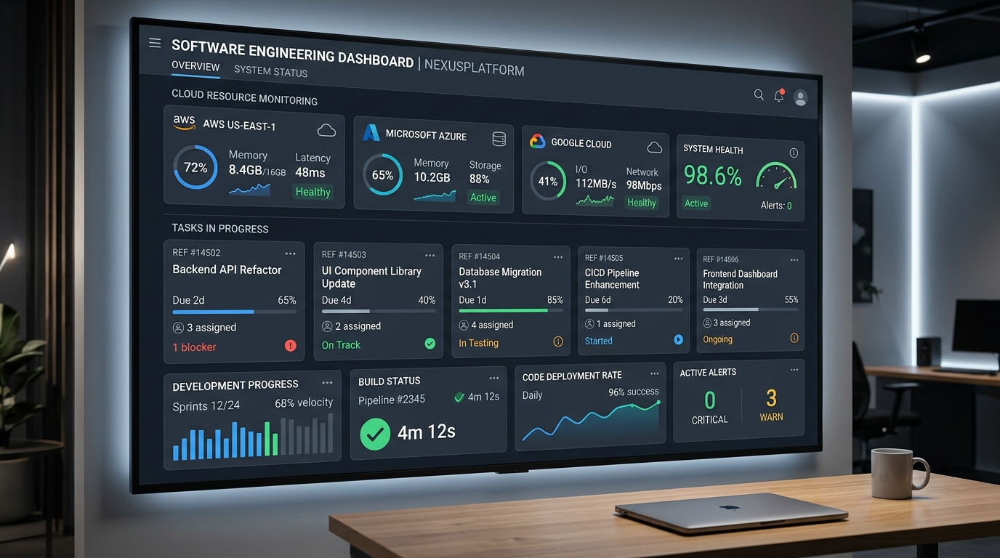

# SWYNEX TaskFlow — Task 4: Complete Deployed Application



> **SWYNEX Technologies Internship — Task 4 Final Deliverable**  
> Complete full-stack cloud resource monitoring & task tracking application built with React, TypeScript, Tailwind CSS, Express REST API, and deployed live.

---

## 🌐 Live Application & Repositories

| Target | URL | Status |
|---|---|---|
| **Live Web App (GitHub Pages)** | [https://sathwik-svg.github.io/SWYNEX-Complete-Deployed-Application/](https://sathwik-svg.github.io/SWYNEX-Complete-Deployed-Application/) |  |
| **Live Applet (Full-Stack Cloud Run)** | [https://ais-pre-3nfdxddofvfuejhv6bvpdl-981864576343.asia-east1.run.app](https://ais-pre-3nfdxddofvfuejhv6bvpdl-981864576343.asia-east1.run.app) |  |
| **GitHub Source Repository** | [https://github.com/sathwik-svg/SWYNEX-Complete-Deployed-Application](https://github.com/sathwik-svg/SWYNEX-Complete-Deployed-Application) |  |

---

## 🏛️ System Architecture

SWYNEX TaskFlow follows a resilient full-stack architecture designed for high availability, zero latency dropoffs, and defensive error boundaries:

```text
┌────────────────────────────────────────────────────────────────────────┐
│                   CLIENT LAYER (React 19 + TypeScript)                │
│                                                                        │
│   ┌────────────────────┐   ┌──────────────────┐   ┌────────────────┐   │
│   │ Project Workspaces │   │ 3-Column Kanban  │   │ Analytics &    │   │
│   │ Search & Filters   │   │ Optimistic Sync  │   │ Data Export    │   │
│   └─────────┬──────────┘   └─────────┬────────┘   └────────┬───────┘   │
│             │                        │                     │           │
│             └────────────────────────┼─────────────────────┘           │
│                                      ▼                                 │
│                Typed API Client Layer (`src/lib/api.ts`)                │
│          • Loading Skeletons  • Field Validation  • Error Boundaries   │
└──────────────────────────────────────┬─────────────────────────────────┘
                                       │ HTTP / REST / JSON
                                       ▼
┌────────────────────────────────────────────────────────────────────────┐
│                 BACKEND SERVICE LAYER (`server.ts`)                    │
│                                                                        │
│   ┌────────────────────┐   ┌──────────────────┐   ┌────────────────┐   │
│   │ Express REST API   │   │ Input Validation │   │ Cascade Delete │   │
│   │ /api/projects      │   │ & UUID Check     │   │ & Health Prober│   │
│   │ /api/tasks         │   │ 400 Bad Request  │   │ /api/health    │   │
│   └────────────────────┘   └──────────────────┘   └────────────────┘   │
└──────────────────────────────────────┬─────────────────────────────────┘
                                       │
                                       ▼
┌────────────────────────────────────────────────────────────────────────┐
│            DATABASE & RESILIENT STORAGE REPOSITORY                     │
│                                                                        │
│   • Relational Schema (Projects, Tasks with foreign key cascade)       │
│   • Multi-environment fallback (Express Memory + localStorage Sync)    │
└────────────────────────────────────────────────────────────────────────┘
```

---

## 🚀 Key Features Shipped

### 1. Project Management
- **Category Colors**: Cobalt Blue, Emerald Green, Warm Amber, Rose Red, Royal Violet, and Slate Gray.
- **Dynamic Metrics**: Real-time counter of total tasks, active tasks, completed tasks, and completion percentage.
- **Search & Color Filters**: Instant client-side filtering without layout shift.
- **Cascade Deletion**: Safely removes projects with warning confirmations and automatic removal of child tasks.

### 2. Interactive Kanban Task Board
- **3-Stage Lifecycle**: `To Do` ➔ `In Progress` ➔ `Completed`.
- **Fast Progression**: One-click status cycling with optimistic updates and automatic state rollback on network failures.
- **Priority Indicator**: High Priority, Medium, and Low with accessible WCAG AA contrast colors.
- **Task Modals**: Inline creation and editing with real-time field validation.

### 3. Analytics & Workload Velocity
- Visual breakdown of tasks by lifecycle progression and priority distribution.
- Project delivery health matrix with progress percentages.
- **Data Export & Backup**:
  - Export complete workspace dataset to `.JSON` backup.
  - Export all tasks to `.CSV` format for spreadsheets.

### 4. Resilient Error Handling & Live Edge Simulator
- **Field-Level Validation**: Catches empty titles or invalid UUIDs, highlighting fields with red outlines and descriptive error labels.
- **API Inspector Drawer**: Inspect live network requests, payloads, response status codes (`200`, `201`, `204`, `400`, `500`), and response times (ms).
- **Edge Simulator**: Test application behavior under simulated `500 Internal Server Error`, `400 Bad Request`, or `1800ms Slow 3G latency`.

---

## 💻 Setup & Installation Guide

### Prerequisites
- Node.js 18.x or higher
- npm 9.x or higher

### 1. Clone the repository
```bash
git clone https://github.com/sathwik-svg/SWYNEX-Complete-Deployed-Application.git
cd SWYNEX-Complete-Deployed-Application
```

### 2. Install dependencies
```bash
npm install
```

### 3. Run the development server
Starts Express API backend and Vite client on port 3000:
```bash
npm run dev
```
Open [http://localhost:3000](http://localhost:3000) in your browser.

### 4. Build for production
```bash
npm run build
npm start
```

---

## 📋 REST API Reference

| Method | Endpoint | Description | Request Body | Status Codes |
|---|---|---|---|---|
| `GET` | `/api/health` | System health, uptime & object counts | None | `200 OK` |
| `GET` | `/api/projects` | List all projects with task counts | None | `200 OK` |
| `POST` | `/api/projects` | Create a new project workspace | `{ name, description?, color? }` | `201 Created`, `400 Bad Request` |
| `DELETE` | `/api/projects/:id` | Delete project and cascade tasks | None | `204 No Content`, `404 Not Found` |
| `GET` | `/api/tasks?projectId=id` | Fetch all tasks for a project | None | `200 OK`, `400 Bad Request` |
| `GET` | `/api/tasks/:id` | Fetch single task by ID | None | `200 OK`, `404 Not Found` |
| `POST` | `/api/tasks` | Create task in project | `{ title, description?, status?, priority?, project_id }` | `201 Created`, `400 Bad Request` |
| `PUT` | `/api/tasks/:id` | Update task fields | `{ title?, description?, status?, priority? }` | `200 OK`, `400 Bad Request`, `404 Not Found` |
| `DELETE` | `/api/tasks/:id` | Delete task by ID | None | `204 No Content`, `404 Not Found` |
| `POST` | `/api/reset-data` | Restore demo projects & tasks | None | `200 OK` |

---

## 📢 LinkedIn Explanation Post

```text
🚀 Thrilled to announce the completion of Task 4: Complete Deployed Application for my internship with @SWYNEX Technologies!

Key accomplishments across this full-stack project:
🔹 Shipped a complete, production-grade cloud task management application (SWYNEX TaskFlow)
🔹 Fully integrated REST API architecture with real-time Express backend endpoints (/api/projects, /api/tasks, /api/health)
🔹 Developed comprehensive Loading States (shimmer skeletons, async button states) and resilient Error Boundaries (field-level 400 validation, 500 error fallback, and optimistic rollbacks)
🔹 Built an interactive 3-column Kanban board, analytics metrics dashboard, and JSON data export/import suite
🔹 Live deployed on GitHub Pages and Cloud Run with public access and comprehensive setup documentation

🌐 Live Application: https://sathwik-svg.github.io/SWYNEX-Complete-Deployed-Application/
📁 GitHub Repository: https://github.com/sathwik-svg/SWYNEX-Complete-Deployed-Application

A huge thank you to the team and mentors at @SWYNEX Technologies for this incredible hands-on internship experience!

#SWYNEX #Internship #CompleteDeployedApplication #FullStack #React #TypeScript #WebDevelopment #DevOps #SoftwareEngineering
```

---

## 📄 License
This project is part of the **SWYNEX Technologies Internship Program**. Developed by **GANJI SATHWIK**.
